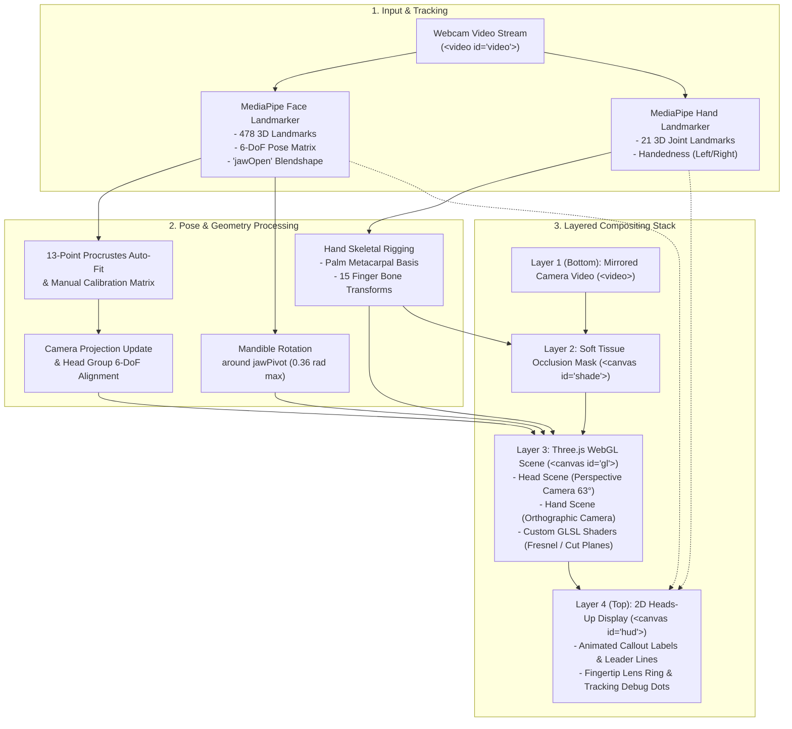

# X-Ray Mirror

> **Real-time Augmented Reality Anatomical Mirror in Your Browser.**  
> Track your skull, brain, facial muscles, and hand skeleton live through your webcam with zero build tools and complete privacy.

[](https://developer.mozilla.org/en-US/docs/Web/HTML)
[](https://threejs.org/)
[](https://developers.google.com/mediapipe)
[](https://www.khronos.org/webgl/)
[](#getting-started)
[](#privacy--security)
[](https://lifesciencedb.jp/bp3d/)

---

## Overview

**X-Ray Mirror** is a single-file, client-side Augmented Reality application that transforms any standard webcam into a real-time anatomical mirror. By fusing **Google MediaPipe** computer vision models with custom **Three.js WebGL shaders**, it tracks the user's face and hands in 3D camera-space and pins a detailed human anatomy model (derived from the scientific BodyParts3D dataset) directly to their body.

As you speak, turn, nod, tilt, or open your mouth, the virtual skull, articulated mandible, cerebrum, hindbrain, and facial muscles move in lockstep with your motion. Lift your hands to reveal an articulated 3D hand skeleton with real-time soft tissue occlusion, or use your index fingertip as an interactive **X-ray lens** to explore subcutaneous anatomy.

> [!NOTE]
> **Privacy First**: All computer vision, geometric decoding, and WebGL rendering occur **100% locally on your computer**. No video streams, images, or telemetry are ever uploaded or transmitted over the network.

---

## Key Features

- **Multi-Layer Anatomical Visualization**:
  - **Skull & Mandible**: Complete cranium with a dynamically articulated lower jaw that pivots realistically as you open your mouth.
  - **Brain**: Segmented cerebrum, occipital/temporal/parietal/frontal lobes, hindbrain (cerebellum), pons, and medulla oblongata.
  - **Muscles**: Core facial and masticatory musculature including the frontalis, temporalis, orbicularis oculi, orbicularis oris, zygomaticus major, masseter, and mentalis.
  - **Eyes & Skin Veil**: Bilateral eyeballs positioned inside orbits and an outer skin outline/veil with gradient neck fade.
- **Articulated 3D Hand Skeleton**:
  - Live 21-joint skeletal tracking for up to two hands simultaneously.
  - Reconstructed palm block (carpal/metacarpal complex) and 15 finger phalanges per hand.
  - Custom 2D soft tissue occlusion veil with adjustable edge blur that masks real flesh behind the bones for a genuine radiograph look.
- **Interactive X-Ray Lens**:
  - Circular reveal aperture that dynamically tracks your **index fingertip** (or cursor/face) in real-time.
  - Allows you to "brush" across your face and peer beneath the skin layer by layer.
- **Dual Visual Styles**:
  - **X-Ray Radiograph**: Additive blending with custom Fresnel rim illumination (`pow(1.0 - ndv, 2.1)`), causing bone edges and muscle contours to glow while flat areas remain translucent.
  - **Solid Anatomical Model**: Normal blending with depth testing, directional shading (`dot(N, L)`), and specular rim highlights.
- **Dynamic Mixed Reality & Reveal Planes**:
  - Reveal presets: *Whole Head*, *Left Half Only*, *Right Half Only*, *Top of Head*, *Lower Face*, and *X-Ray Lens*.
  - Configurable edge feathering (`smoothstep` cut borders) and adjustable real-world camera feed transparency.
- **Intelligent Anatomical Callouts**:
  - Dynamic 2D/3D leader lines pointing to **26 anatomical landmarks** across the head and **5 hand bone zones**.
  - Automatic column balancing (left/right split), depth-aware occlusion (hidden interior structures are suppressed in Solid mode), and vertical rank stabilization to eliminate label jitter.
- **Custom Fit & Auto-Calibration**:
  - Automated 13-point Procrustes-style scale and translation calibration aligning 3D anatomical anchor points with 2D MediaPipe landmarks.
  - Manual calibration sliders for overall scale (70%–140%), independent X/Y/Z stretch, and 3D offset translations in centimeters.
  - Persistent settings stored automatically in browser `localStorage`.
- **Built-in Demo & Testing Suite**:
  - Headless demo mode (`#demo`) simulating live head and hand motion without requiring webcam hardware or permissions.
  - Diagnostic telemetry overlay (`Show tracking data`) tracking FPS, Euler head rotation angles, jaw displacement, camera distance, and landmark counts.

---

## System Architecture

X-Ray Mirror uses a four-layer composite rendering stack synchronized on every browser animation frame:



### Layer Composite Stack

| Layer Element | Technology | Purpose |
| :--- | :--- | :--- |
| `<video id="video">` | HTML5 Media Stream | Mirrored live camera feed forming the real-world baseline. |
| `<canvas id="shade">` | Canvas 2D Context | Renders a blurred, dark silhouette (veil) over tracked hands to occlude natural skin and highlight bones. |
| `<canvas id="gl">` | Three.js / WebGL | Dual-scene 3D renderer: Perspective scene for head anatomy and Orthographic scene for hand skeleton. |
| `<canvas id="hud">` | Canvas 2D Context | High-DPI overlay rendering dynamic callout text, leader lines, lens border, and tracking diagnostics. |

---

## 3D Anatomy & Compression Pipeline

The 3D anatomical models originate from the scientific **BodyParts3D** database (The Database Center for Life Science, Japan). To deliver high-fidelity anatomical fidelity in a zero-download web app, geometry is packed into a high-density binary format:

- **16-bit Spatial Quantization**: Vertex coordinates are normalized and stored as 16-bit unsigned integers (`Uint16Array`), reducing vertex storage by 50% compared to standard 32-bit floats.
- **Single Embedded Binary Stream**: All 23 meshes are packed into a single binary buffer and base64-encoded into the `<script id="meshdata">` element.
- **Client-Side Buffer Reconstruction**: On startup, `decodeMeshes()` decodes the base64 string, reconstructs 3D bounding boxes, generates vertex normals, and populates Three.js `BufferGeometry` instances in milliseconds.

```
Total Meshes:      23
Total Vertices:    113,248
Total Indices:     676,497
Total Triangles:   225,499
Compressed Size:   ~2.05 MB (Embedded directly within index.html)
```

---

## Anatomical Landmarks & Labels

X-Ray Mirror includes **26 annotated head structures** and **5 hand skeletal divisions**:

### Head Anatomy

| Category | Structures Included |
| :--- | :--- |
| **Skull / Cranium** (9) | Frontal bone, Parietal bone, Temporal bone, Occipital bone, Nasal bone, Zygomatic bone (cheekbone), Maxilla (upper jaw), Teeth, Mandible (lower jaw with active pivot) |
| **Brain** (7) | Frontal lobe, Parietal lobe, Temporal lobe, Occipital lobe, Cerebellum, Pons (brainstem), Medulla oblongata |
| **Muscles** (9) | Frontalis, Temporalis, Orbicularis oculi, Nasalis, Zygomaticus major, Masseter, Orbicularis oris, Depressor anguli oris, Mentalis |
| **Eyes** (1) | Eyeballs (bilateral) |

### Hand Anatomy

| Region | Structures Included |
| :--- | :--- |
| **Phalanges** | Distal phalanx, Middle phalanx, Proximal phalanx |
| **Metacarpus** | Metacarpal bones (five rays) |
| **Carpus** | Carpal bones (wrist complex) |

---

## Getting Started

X-Ray Mirror requires **no package managers, no compilation, and no bundlers**. It runs directly in any modern web browser.

### Prerequisites

- A web browser supporting **WebGL 2.0** and **ES Modules** (Chrome, Edge, Safari, Firefox).
- A connected webcam (USB or built-in).
- A local HTTP server (browsers require HTTPS or `localhost` to grant camera permissions).

### 1. Clone the Repository

```bash
git clone https://github.com/faha1999/xray-mirror.git
cd xray-mirror
```

### 2. Launch a Local HTTP Server

Choose any of the following lightweight static servers:

```bash
# Using Python 3 (recommended)
python3 -m http.server 8000

# Using Node.js npx
npx serve .

# Using PHP
php -S localhost:8000
```

### 3. Open in Browser

Navigate to:
```
http://localhost:8000/
```
Click **Start camera** and grant camera permission when prompted.

---

## Controls & Interface Guide

```
+-----------------------------------+-----------------------------------+
|            LIVE STAGE             |           CONTROL PANEL           |
|                                   |                                   |
|   +---------------------------+   |  [Status: Tracking your head]     |
|   |                           |   |                                   |
|   |         ( ' - ' )         |   |  LAYERS                           |
|   |       /  Skull  \         |   |  [Skull] [Brain] [Muscles] [All]  |
|   |      (   Brain   )        |   |  [x] Skull    [x] Eyes            |
|   |       \_________//        |   |  [ ] Brain    [x] Head outline    |
|   |                           |   |  [ ] Muscles  [x] Hand bones      |
|   |    [o] Lens               |   |  [x] Show labels                  |
|   |     \  (Fingertip)        |   |                                   |
|   |      \__ Hand bones       |   |  LOOK                             |
|   |                           |   |  [ X-Ray ]  [ Solid ]             |
|   +---------------------------+   |  Brightness  [----o-----]         |
|                                   |                                   |
|                                   |  MIXED REALITY                    |
|                                   |  Real me opacity  [---o------]    |
|                                   |  Edge feather     [--o-------]    |
|                                   |  Reveal: [ X-ray lens       v ]   |
|                                   |                                   |
|                                   |  FIT TO MY HEAD                   |
|                                   |  Size / W / H / D / X / Y / Z     |
+-----------------------------------+-----------------------------------+
```

### Control Sections

1. **Layers & Presets**:
   - Quick preset buttons: `Skull`, `Brain`, `Muscles`, `Everything`.
   - Independent layer toggles for Skull, Brain, Muscles, Eyes, Head Outline, and Hand Bones.
   - `Show labels`: Toggle non-overlapping anatomical callouts.
2. **Look**:
   - `X-ray`: Translucent additive Fresnel glow.
   - `Solid`: Opaque, lit anatomical specimen with depth testing.
   - `Brightness`: Adjusts emission intensity and shader gain.
3. **Mixed Reality**:
   - `Real me showing through`: Blends the real camera feed into the anatomical overlay.
   - `Edge feather`: Softens anatomical silhouettes and cut borders into the camera view.
   - `Reveal`: Select from *Whole head*, *Left half*, *Right half*, *Top of head*, *Lower face*, or *X-ray lens*.
4. **Fit to My Head**:
   - Fine-tune alignment with sliders for overall size, width, height, depth stretch, and 3D translation (Left/Right, Up/Down, Forward/Back in centimeters).
   - `Reset fit`: Restores default auto-calibrated scale.
5. **Show tracking data**:
   - Displays real-time telemetry including detected facial points, estimated subject distance in cm, yaw/pitch/roll Euler angles, jaw openness ratio, and rendered FPS.

---

## Testing & Demo Mode

You can explore X-Ray Mirror without a webcam or test automated workflows using the built-in demo mode:

| URL / Query Parameter | Description |
| :--- | :--- |
| `http://localhost:8000/#demo` | Runs an automated simulation: animated head rotation, nodding, jaw movement, and hand skeletal positioning. |
| `http://localhost:8000/#demo?still` | Pauses simulation on a single static frame for reproducible visual inspection. |
| `http://localhost:8000/#demo?dump` | Captures and composites all visual layers into a downloadable PNG image for testing. |

---

## Repository Structure

```
xray-mirror/
├── index.html          # Primary production application (zero-build, all-inclusive)
├── X-Ray Mirror.html   # Mirror copy of index.html for direct local launch
└── README.md           # Project documentation and architectural guide
```

---

## Privacy & Security

- **Zero Cloud Processing**: Video streams never leave the client's local memory.
- **No Analytics / Telemetry**: No tracking cookies, telemetry beacons, or third-party monitoring scripts are embedded.
- **Local Storage**: Calibration settings are stored exclusively in the browser's origin-scoped `localStorage`.

---

## License & Medical Disclaimer

### Medical Disclaimer

> [!CAUTION]
> **Not a Medical Device**: X-Ray Mirror is designed solely for **educational, artistic, and demonstration purposes**.
> The anatomical geometry is based on a standardized 3D anatomical reference dataset of an adult and is dynamically scaled to match facial contours. It **does NOT** represent a medical scan, CT, MRI, or diagnostic radiograph of the individual user and must **never** be used for medical assessment, diagnosis, or clinical evaluation.

### Credits & Attribution

- **Anatomical Models**: [BodyParts3D](https://lifesciencedb.jp/bp3d/), © The Database Center for Life Science (DBCLS), licensed under [Creative Commons Attribution-ShareAlike 2.1 Japan (CC BY-SA 2.1 JP)](https://creativecommons.org/licenses/by-sa/2.1/jp/). Models were re-aligned, simplified, and quantized for real-time web rendering.
- **Computer Vision**: [Google MediaPipe Tasks Vision](https://developers.google.com/mediapipe) (FaceLandmarker & HandLandmarker models).
- **3D Engine**: [Three.js](https://threejs.org/) (MIT License).

---

<p align="center">
  Crafted with WebGL, MediaPipe, and Three.js.
</p>
